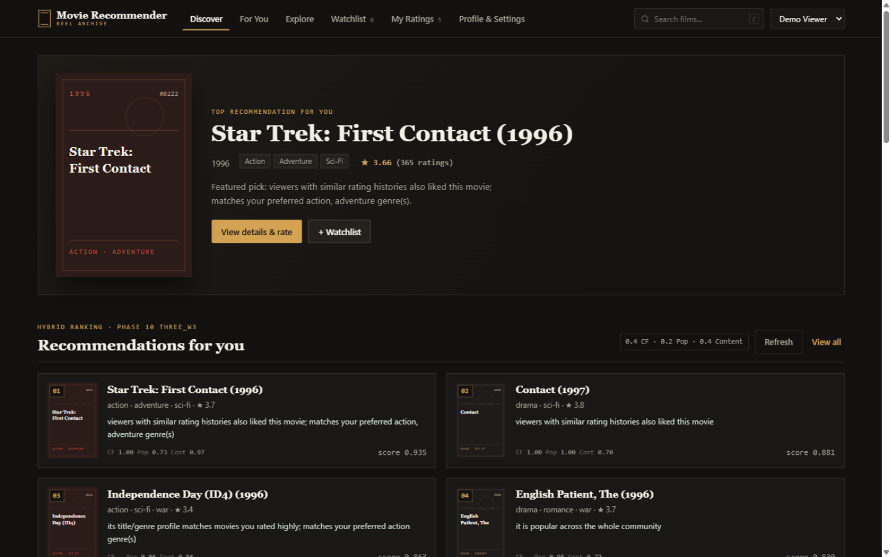
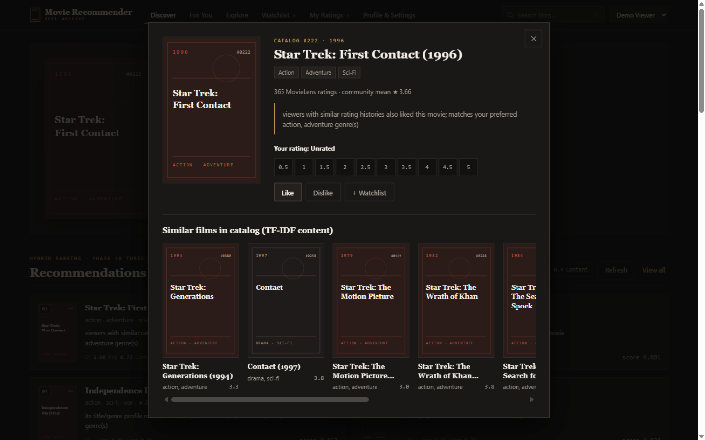

# Movie Recommendation System — Hybrid ML Recommender

An end-to-end, CPU-first movie recommendation system and local web application built from scratch in Python. The project combines an offline multi-phase experimental benchmark suite (MovieLens 100K, MovieLens 1M, and GroupLens Personality 2018) with a self-contained editorial web application powered by a hybrid ranking engine, SQLite persistence, and optional TMDB metadata enrichment.

> **Independent Engineering & Research Project:** Built from the ground up with no external ML framework lock-in (Python standard library core with optional NumPy acceleration). Zero thesis code, checkpoints, or private data are included.

---

## 1. Project Objectives

- **Build an auditable hybrid recommender from first principles** — implement collaborative filtering, content-based filtering, and popularity baselines without black-box wrappers, verifying every score and explanation mathematically.
- **Evaluate rigorously without target leakage** — enforce strict chronological per-user splits, train-only normalization/statistics, nested inner-validation tuning, and paired user-cluster bootstrap confidence intervals.
- **Investigate personality-aware recommendation honestly** — test whether Big Five personality signals improve ranking accuracy in both controlled synthetic benchmarks and real linked participant data (GroupLens Personality 2018), preserving negative results transparently.
- **Deliver a fast, locally runnable web application** — serve sub-10 ms recommendations, catalog exploration, watchlists, rating history, and interactive explanations through a responsive single-page interface.

---

## 2. Main Features

- **Personalized Hybrid Recommendations (`For You` & `Discover`):** Combines collaborative filtering, popularity, and TF-IDF content similarity (`0.40 CF + 0.20 Popularity + 0.40 Content`) with component-level score breakdowns (`CF`, `Pop`, `Cont`) and honest plain-English explanations.
- **Editorial Cinema Web UI:** Responsive dark-mode single-page interface across `Discover`, `For You`, `Explore`, `Watchlist`, `My Ratings`, and `Profile & Settings` views with deterministic 2:3 archival SVG posters as instant offline artwork.
- **Catalog Search & Multi-Filter Browsing:** Filter by genre, release year range, and minimum community rating; sort by popularity, highest rated (minimum support threshold), newest/oldest release, or title; find TF-IDF content-similar films on any detail modal.
- **Persistent Multi-User SQLite Storage:** Isolated local user profiles, `0.5–5.0` star ratings, like/dislike actions, watchlists, per-user reset, WAL concurrency safety, and online SQLite `.backup()` support.
- **Optional TMDB Metadata & Artwork Enrichment:** Opt-in integration (`TMDB_READ_TOKEN` or `TMDB_API_KEY`) for posters, backdrops, synopses, runtime, directors, and cast — cached persistently in SQLite with circuit-breaker cooldowns and optional SOCKS5/HTTP proxy support (`TMDB_PROXY`, off by default).
- **Optional Experimental Personality Module:** Disabled by default (`PERSONALITY_ENABLED = False`). Opt-in users can store self-reported 1–7 Big Five scores and explicitly invoke an experimental Ridge-blended endpoint without affecting standard recommendations.

---

## 3. System Architecture

```text
┌─────────────────────────────────────────────────────────────────────────┐
│ Frontend (recommender/app/static/: index.html, styles.css, app.js)      │
│ Editorial Cinema SPA · Deterministic 2:3 SVG Posters · Responsive Grid  │
└──────────────────────────────────┬──────────────────────────────────────┘
                                   │ JSON / HTTP (127.0.0.1:8000)
┌──────────────────────────────────▼──────────────────────────────────────┐
│ HTTP Server (recommender/app/server.py — ThreadingHTTPServer)           │
│ Security Headers · Bounds Validation · Optional /api/tmdb_image Cache   │
└──────────────┬───────────────────────────────────────┬──────────────────┘
               │                                       │
┌──────────────▼──────────────────┐     ┌──────────────▼──────────────────┐
│ Recommendation Service          │     │ Storage & Metadata Layer          │
│ (recommender/app/service.py)    │     │ - storage.py (SQLite WAL + Lock)│
│ - Phase 7 ItemItemCF (100 nbrs) │     │   users, ratings, watchlist,    │
│ - Phase 2 TF-IDF Content        │     │   personality, movie_metadata   │
│ - Phase 10 three_w3 Hybrid      │     │ - metadata.py (Optional TMDB +  │
│ - Experimental Ridge Blend (off)│     │   optional SOCKS5/HTTP proxy)   │
└─────────────────────────────────┘     └─────────────────────────────────┘
```

### Repository Layout

- `recommender/` — Core recommendation engine (`data.py`, `datasets.py`, `popularity.py`, `collaborative.py`, `content.py`, `hybrid.py`, `evaluation.py`, `nested.py`, `diagnostics.py`, `robustness.py`), phase-isolated research modules (`phase7/`, `phase9/`, `phase10/`, `phase11/`, `phase12/`, `phase13/`, `personality/`), and web application (`app/`).
- `scripts/` — CLI entry points for dataset download/validation, offline benchmarks (`evaluate_models.py`, `nested_evaluation.py`, `phase6`–`phase13`), and launching the web app (`run_app.py`).
- `tests/` — Automated `unittest` suite (`151` tests across Phases 1–16).
- `configs/` — Reproducible JSON experiment and model configurations.
- `notebooks/` — Colab starter notebook for hardware inspection and MovieLens validation.
- `docs/screenshots/` — Application UI screenshots.

---

## 4. Recommendation Algorithms

The production engine builds on a three-signal hybrid ranking pipeline (`Phase 10 three_w3`) executed over a fixed `popularity@200` unseen candidate pool:

### 4.1 Hybrid Recommendation Methodology (`three_w3`)

1. **Candidate Generation:** Retrieve the top `200` unseen movies ranked by training/community popularity (`popularity@200`), ensuring fast (`~1 ms`) scoring and bounded latency.
2. **Per-Pool Min-Max Normalization:** Normalize each available signal (`CF`, `Popularity`, `Content`) independently onto `[0, 1]` across the user's candidate pool (assigning `0.5` when a pool has zero span).
3. **Missing-Signal Weight Renormalization:** When collaborative filtering cannot score a candidate (e.g., zero co-rating overlap), weights are renormalized over the signals present for that item rather than dropping candidates or leaking raw scales.
4. **Weighted Fusion:**
   $$\text{score}(u, i) = \frac{0.40 \cdot \tilde{s}_{\text{CF}}(u, i) + 0.20 \cdot \tilde{s}_{\text{Pop}}(i) + 0.40 \cdot \tilde{s}_{\text{Content}}(u, i)}{\sum_{k \in \text{present}(u, i)} w_k}$$
5. **Cold-Start Fallback & Explanations:** Users with zero ratings receive the popularity ranking; rated users receive component-derived explanations reflecting whichever normalized signals actually drove the item's score.

### 4.2 Collaborative Filtering

- **Algorithm:** Centered item-item k-Nearest Neighbors (`ItemItemCF`), computing Pearson-style mean-centered cosine similarity strictly over co-rating user intersections.
- **Regularization & Shrinkage:**
  - Similarity shrinkage ($\lambda_{\text{sim}} = 10.0$) dampens pairs with small co-rating counts.
  - Top-$k$ neighborhood truncation (`neighbors = 100` in the application runtime; `20/50/100` in nested tuning).
  - Prediction confidence shrinkage ($\lambda_{\text{pred}} = 100.0$) shrinks predictions toward item baselines when few neighbors overlap, clipped to `[0.5, 5.0]`.
- **Acceleration:** `recommender/phase7/cf_adapter.py` executes the exact co-rating-only math in 512-column chunked NumPy operations (`~6 s` on MovieLens 1M) with an automatic pure-Python fallback when NumPy is absent.

### 4.3 Content-Based Filtering

- **Item Representation:** L2-normalized TF-IDF vectors built from tokenized movie titles and MovieLens genre tags (`recommender/content.py`).
- **User Profile:** Rating-deviation weighted sum of liked/rated item TF-IDF vectors (`r - user_mean`), scored by cosine similarity against unseen candidates. Also powers the `Similar Films` and `Because You Liked` discovery rails.

### 4.4 Popularity-Based Recommendations

- **Scoring:** Bayesian-average community rating smoothed by prior count (`prior_count = 10.0`) paired with interaction counts for candidate pool selection (`popularity@200`).
- **Role:** Serves cold-start users cleanly, anchors catalog browse defaults, and stabilizes hybrid scores when individual users have sparse co-rating histories.

---

## 5. Optional Experimental Personality Module

An experimental personality pathway (`recommender/app/service.py` + `recommender/phase11/`) is included strictly as an **opt-in research capability** and is **disabled by default (`PERSONALITY_ENABLED = False`)**:

- Standard recommendations (`/api/recommendations`, `/api/discover`) **never** read the `personality` table or load personality models.
- Opt-in users can enter self-reported Big Five (OCEAN) scores on a `1–7` scale in `Profile & Settings`.
- Calling `POST /api/personality/recommendations` (requires `NumPy` and at least `5` profiled users with ratings) fits a 42-feature `RidgePersonalityModel` ($\alpha = 5.0$, trait $\times$ genre/attribute interactions) and blends it with `three_w3` (default blend weight `0.15`, clearly labeled `experimental`).
- **Research Finding (Phase 13 Outcome D):** In preregistered offline validation on the real **GroupLens Personality 2018** dataset (`1,820` linked participants, `1,020,429` ratings), **personality signals did not establish measurable recommendation improvements**: nested inner validation selected personality blend weight `w_p = 0.0` in every condition, correct vs. shuffled/random personality profiles were statistically indistinguishable across warm, sparse, and cold-start strata, and personality-only ranking underperformed popularity at zero history.

---

## 6. Installation Instructions

### Requirements

- **Python:** 3.10 or newer (tested on Python 3.11).
- **Dependencies:** Core application and Phases 1–6 run on the **Python standard library alone** (`pyproject.toml` has `dependencies = []`).
- **Optional:** `numpy` (accelerates MovieLens 1M CF startup from `~220 s` to `~6–9 s` and is required if invoking the optional experimental personality Ridge endpoint).

```bash
# 1. Clone the repository
git clone https://github.com/alitava1/movie-recommender.git
cd movie-recommender

# 2. (Optional) Create a virtual environment and install NumPy for faster ML-1M CF builds
python -m venv .venv
# Windows PowerShell: .venv\Scripts\Activate.ps1
# Linux / macOS:      source .venv/bin/activate
pip install numpy

# 3. Download MovieLens 100K (or ml-1m) locally under data/raw/
python scripts/download_dataset.py --dataset ml-100k
python -I scripts/validate_dataset.py --dataset ml-100k
```

> **Dataset Terms:** MovieLens datasets are provided by GroupLens Research (`data/raw/` is excluded from Git via `.gitignore`). Review GroupLens licensing terms before redistributing any dataset files.

---

## 7. Configuration Instructions

The application runs completely offline with zero configuration using archival SVG posters and local MovieLens metadata. Optional environment variables and CLI flags:

| Setting | Default | Description |
|---|---|---|
| `--dataset` | `ml-100k` | Catalog to load (`ml-100k` or `ml-1m`). |
| `--host` / `--port` | `127.0.0.1` / `8000` | Local HTTP bind address and port. |
| `TMDB_READ_TOKEN` / `TMDB_API_KEY` | unset | Optional TMDB v4 Bearer token or v3 API key for live posters, backdrops, synopses, and credits (cached in SQLite; never sent to frontend JS). |
| `MOVIELENS_LINKS_PATH` | `data/raw/<dataset>/links.csv` | Optional MovieLens `links.csv` (`movieId,imdbId,tmdbId`) for exact ID lookup without title search. |
| `TMDB_PROXY` / `--tmdb-proxy` | unset (disabled) | Optional SOCKS5/HTTP proxy URL (e.g., `socks5h://127.0.0.1:10808`) for networks where TMDB is unreachable directly. Routes TMDB API & `/api/tmdb_image` requests through the proxy and caches images locally. |

---

## 8. How to Run the Application

```bash
# Start with MovieLens 100K (~0.8s startup)
python scripts/run_app.py

# Or start with MovieLens 1M (~9.2s startup with NumPy)
python scripts/run_app.py --dataset ml-1m
```

Open **[http://127.0.0.1:8000](http://127.0.0.1:8000)** in your browser.

### Optional Offline Research Scripts

```bash
python -I scripts/build_models.py --dataset ml-100k
python -I scripts/run_demo.py --user 1
python -I scripts/evaluate_models.py
python -I scripts/nested_evaluation.py
```

---

## 9. How to Execute Tests

```bash
# Full automated test suite (151 unit & integration tests across Phases 1–16)
python -m unittest discover -s tests -v

# Isolated stdlib-only check (skips NumPy-dependent tests gracefully)
python -I -m unittest discover -s tests -p "test_phase16_*.py" -v
```

Test coverage includes dataset validation, path-traversal download guards, CF pure-Python vs. chunked-NumPy equivalence, leakage-free temporal splitting, paired bootstrap statistics, SQLite WAL concurrency and online backups, HTTP security headers, TMDB mock caching & optional SOCKS5 handshake verification, and end-to-end UI API workflows.

---

## 10. Benchmark Results

### 10.1 Application Runtime Benchmark (Leakage-Free Chronological ML-1M, `n = 500` users)

All models fit strictly on each user's chronologically earlier `outer_train` interactions before evaluating the single latest positive (`rating >= 4.0`) interaction over the app's runtime `popularity@200` unseen pool:

| System | NDCG@10 | MAP@10 | HR@10 | Recall@10 | Catalog Coverage |
|---|---:|---:|---:|---:|---:|
| `popularity` (pool order) | 0.0248 | 0.0181 | 0.0480 | 0.0480 | 0.0252 |
| `cf_in_pool` (CF only) | 0.0091 | 0.0059 | 0.0200 | 0.0200 | 0.1051 |
| `content_in_pool` (TF-IDF only) | 0.0135 | 0.0074 | 0.0340 | 0.0340 | 0.0950 |
| **`app_three_w3` (0.4 CF / 0.2 Pop / 0.4 Content)** | **0.0242** | **0.0159** | **0.0520** | **0.0520** | **0.0747** |

On the `popularity@200` runtime pool, `app_three_w3` raises `HR@10` over `popularity` (`0.0520` vs. `0.0480`, `+8.3%`), delivers `3.0×` broader catalog coverage (`0.0747` vs. `0.0252`), and strongly outperforms single-signal CF (`0.0091`) and content (`0.0135`) alone.

### 10.2 Full-Population Offline Evaluation (MovieLens 1M, `n = 6,037` users)

- **Phase 10 `three_w3` on `cf_popularity@200` quota pool:** `0.0251` NDCG@10 with `0.3237` catalog coverage and `7.21%` long-tail share.
- **Phase 10 `combined_a50+pop_penalty_l10` on `popularity@200`:** `0.0261` NDCG@10 (`+28.9%` over `cf_only` `0.0202`, 95% CI `[+0.0031, +0.0086]`), though popularity-pool reranking collapses catalog coverage (`<= 0.0979`).
- **MovieLens 100K (`u1`–`u5` nested evaluation, `3,717` user-folds):** `cf_top100_content_enrichment` reached `0.1574` NDCG@10 (`+0.00660` over `cf_tuned` `0.1508`, cluster CI `[+0.00374, +0.00962]`), **but Phase 7 showed this enrichment gain did not replicate on MovieLens 1M** (`0.02085` vs. `0.02022`, CI `[-0.00047, +0.00184]`).

### 10.3 Measured CPU Latency (Windows, Local CPU-Only)

| Dataset | Startup + CF Build | Search | Browse (sorted) | Recommend (mean / p95) | Discover (full payload) |
|---|---:|---:|---:|---:|---:|
| `ml-100k` (1,682 movies, 100K ratings) | **0.8 s** | 0.28 ms | 0.68 ms | **0.95 ms** / 1.11 ms | 5.24 ms |
| `ml-1m` (3,883 movies, 1M ratings) | **9.2 s** | 0.69 ms | 2.44 ms | **1.09 ms** / 1.66 ms | 13.87 ms |

---

## 11. Research Background & Limitations

This project evolved across 16 disciplined engineering and research phases:

- **Phases 1–6 (ML-100K Foundation & Diagnostics):** Identified why naive min-max score blending hurt hybrid accuracy (`23.9%` of top-10 slots filled by unlinked non-CF items via missing-signal weight renormalization) and fixed it with candidate-pool alignment and local normalization.
- **Phases 7–10 (ML-1M Generalization & Candidate Retrieval):** Demonstrated that `ml-100k` content-enrichment gains do not automatically transfer to `ml-1m`, and that **candidate pool composition** (`cf_popularity@200` vs. `popularity@200`) dominates downstream coverage and accuracy tradeoffs.
- **Phases 11–13 (Synthetic & Real Big Five Personality Studies):** Audited 8 personality datasets (selecting **GroupLens Personality 2018**) and ran a preregistered evaluation across `1,820` participants (`1,020,429` ratings). Inner validation selected `w_p = 0.0` everywhere (**Outcome D**), establishing no measurable benefit from score-level Big Five integration on top of behavioral history.
- **Practical Limitations:**
  - Designed for single-node local execution (no user password authentication, session tokens, or built-in TLS termination).
  - Content vectors rely on MovieLens title tokens and genre tags unless external metadata is configured.
  - Pure-Python mode without NumPy supports `ml-100k` cleanly, while `ml-1m` CF startup takes `~220 s` without NumPy (`~9.2 s` with NumPy).

---

## 12. Screenshots

### Discover View (Featured Recommendation, Hybrid Score Breakdown & Editorial Rails)


### Film Detail Modal (Rating Strip, Watchlist Controls & TF-IDF Similar Films)


---

## 13. Future Improvements

- **Hybrid Candidate Pool Option in UI:** Expose Phase 10's `cf_popularity@200` quota pool as a user-selectable discovery mode to raise catalog coverage from `7.5%` toward `32%` while maintaining low latency.
- **Richer Local Content Features:** Incorporate cached TMDB plot keywords, directors, and cast into TF-IDF / sparse vectors when users opt into metadata enrichment.
- **Multi-User Auth & Reverse Proxy Deployment:** Add optional password hashing, CSRF tokens, and a production ASGI/WSGI wrapper for multi-user network deployments.
